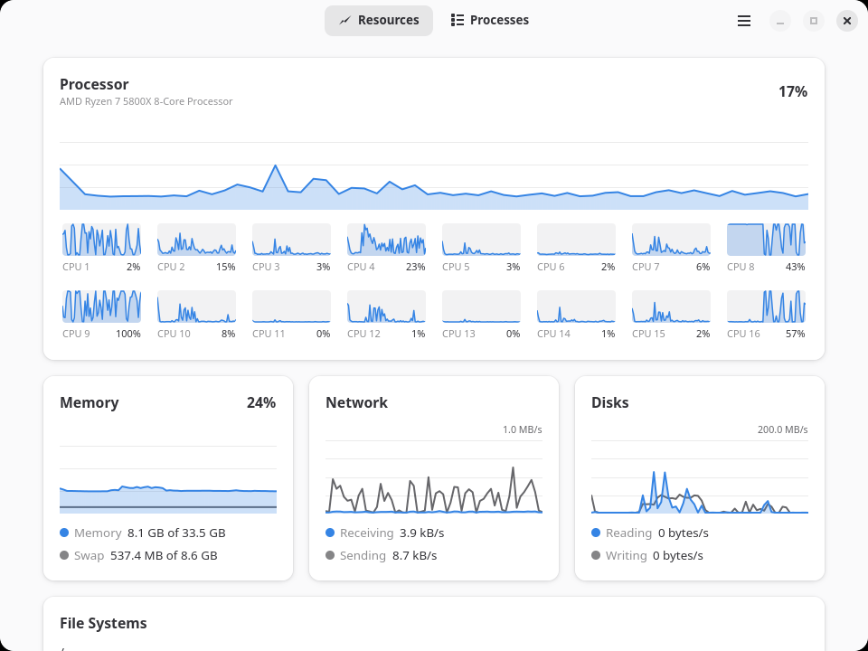

# Locus

Locus is a system monitor for Wayland desktops, written in Rust with GTK 4 and libadwaita.
It was made for the Meridian desktop but does not depend on it, so it runs on any other.

Resources, the page Locus opens on, graphs the processor and each of its cores, memory and
swap, the network, the disks and each graphics card. File Systems shows how much room is
left on each mounted disk, and switches a bar to the warning colour once its disk is 90%
full.

Processes lists the running apps first, each with its processes underneath, then every
other process as a tree under the process that started it. The columns show CPU, memory,
disk and GPU use; the list sorts by any of them and searches by name, command line or PID.
Processes can be ended, killed, stopped and continued, and apps ended or killed with all of
their processes, from the buttons above the list, the context menu (right click or long
press) or the keyboard. Ending and killing ask first, and the list stops re-sorting while a
dialog or menu is open.

Everything is read from `/proc` and `/sys` on a worker thread. Apps are recognised by the
systemd unit the desktop starts them in, by the desktop file GLib launched them from, or,
for apps D-Bus activates, by their program. Processes are read only while the Processes
page is visible, since that is most of the cost of a reading, and file systems only while
File Systems is; the graphs keep going in the background, and while the window is hidden.

Each page refreshes every 2 seconds by default, or every 1, 5 or 10 seconds as set for it
in Preferences. Sizes are shown in binary units (KiB, MiB, GiB), or in decimal units (kB,
MB, GB) when Preferences says so.

GPU usage, video memory and temperature are whatever the driver exposes under `/sys`:
amdgpu provides all three, most other drivers less, some nothing. A GPU that has powered
down while idle, like the discrete GPU of a laptop, is not read, since reading it would
wake it up.

Locus signals processes as the user running it, so it cannot end other users' processes,
root's included, and does not show their disk or GPU use: the kernel exposes those only to
the owner.

## Building and installing

    just build
    sudo just install                   # prefix /usr/local
    just prefix=$HOME/.local build install

Build needs Rust 1.92, `blueprint-compiler`, `just`, gettext and the development packages
for GTK 4.22 and libadwaita 1.8 or newer. `just run` starts the debug build without
installing it. `just uninstall` removes what `install` put in place, with the same prefix.

The interface is available in English, Russian and Ukrainian.

See [CONTRIBUTING.md](CONTRIBUTING.md) for a tour of the code, and
[SECURITY.md](SECURITY.md) for reporting a vulnerability.

Licensed under GPL-3.0-or-later.
