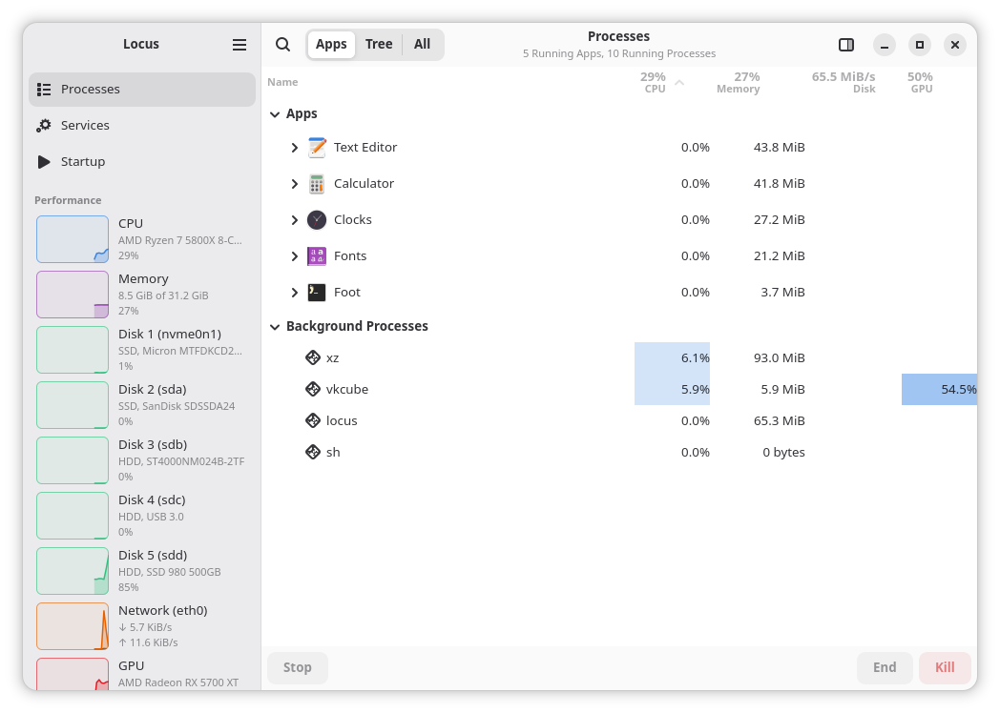

# Locus

Locus is a system monitor for Wayland desktops, written in Rust with GTK 4 and libadwaita.
It was made for the Meridian desktop but does not depend on it, so it runs on any other.

A sidebar leads to the pages. Processes, the page Locus opens on, lists the running apps
first, each with its processes underneath, then every other process; it can also be
arranged as a tree of everything or as a flat list. The columns show CPU, memory, disk and
GPU use, tinted by how much each takes; the list sorts by any of them and searches by name,
command line or PID. Processes can be ended, killed, stopped and continued, and apps ended
or killed with all of their processes, from the buttons beneath the list, the context menu
(right click or long press) or the keyboard. Ending and killing ask first, and the list
stops re-sorting while a dialog or menu is open. A pane beside the list shows more about
what is selected: its threads, open files and network connections, and its priority.

Services lists those of the machine and of the user, from systemd, with what each is doing,
whether it starts at boot and what it uses. They can be started, stopped and restarted, and
each shows the end of its log. Changes to the machine's services go through systemd's own
authorization.

Startup lists the apps that start with the session, with a switch for each and a way to add
more, and breaks down how long the last boot took and which services took longest.

Under Performance, the sidebar has a page and a small live graph for the processor, memory,
each disk, each network connection and each graphics card. Their graphs reach back 1, 2 or
5 minutes, and each page adds what it can say about its device: the processor's speed and
load, how memory is divided, a disk's file systems and how full they are, a connection's
addresses, a graphics card's engines, and the processes using the most of it.

Everything but services is read from `/proc` and `/sys` on a worker thread. Apps are
recognised by the systemd unit the desktop starts them in, by the desktop file GLib launched
them from, or, for apps D-Bus activates, by their program. Processes are read only while a
page that shows them is visible, since that is most of the cost of a reading, and details of
a device only while its page is; the sidebar's graphs keep going in the background, and
while the window is hidden. Services are read at most every 5 seconds, and only while their
page is visible.

Processes refresh every 2 seconds by default, and so do the other pages, or every 1, 5 or 10
seconds as set for each in Preferences. Sizes are shown in binary units (KiB, MiB, GiB), or
in decimal units (kB, MB, GB) when Preferences says so.

GPU usage, video memory and temperature are whatever the driver exposes under `/sys`:
amdgpu provides all three, most other drivers less, some nothing. A GPU that has powered
down while idle, like the discrete GPU of a laptop, is not read, since reading it would
wake it up.

Locus signals processes as the user running it, so it cannot end other users' processes,
root's included, and does not show their disk or GPU use: the kernel exposes those only to
the owner.

## Building and installing

    just build
    sudo just install                   # prefix /usr/local
    just prefix=$HOME/.local build install

Build needs Rust 1.92, `blueprint-compiler`, `just`, gettext and the development packages
for GTK 4.22 and libadwaita 1.8 or newer. `just run` starts the debug build without
installing it. `just uninstall` removes what `install` put in place, with the same prefix.

The interface is available in English, Russian and Ukrainian.

See [CONTRIBUTING.md](CONTRIBUTING.md) for a tour of the code, and
[SECURITY.md](SECURITY.md) for reporting a vulnerability.

Licensed under GPL-3.0-or-later.
